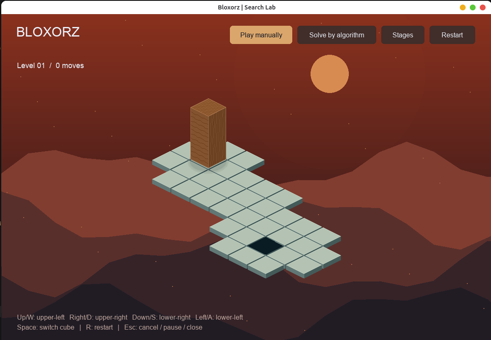

# Bloxorz Solver

Đồ án môn Cơ sở Trí tuệ nhân tạo: xây dựng trò chơi Bloxorz bằng Python và
Pygame, hỗ trợ chơi thủ công hoặc tìm lời giải bằng **BFS, DFS, UCS và A\***.
Mục tiêu là di chuyển khối gỗ sao cho khối đứng thẳng trên ô đích mà không
rơi khỏi bàn chơi.



## Cách chạy

Yêu cầu **Python 3.10 trở lên**. Mở terminal tại thư mục gốc của dự án
(thư mục chứa `main.py`) và kích hoạt môi trường Python bạn đang dùng.

Cài thư viện để chạy game:

```sh
python -m pip install requirements.txt
```

Khởi động trò chơi:

```sh
python main.py
```

## Cách chơi

- Chọn **Play manually** để tự chơi, dùng **phím mũi tên** hoặc **WASD** để di chuyển.
- Nhấn **Space** để đổi khối đang điều khiển khi khối gỗ bị tách đôi.
- Nhấn **R** hoặc **Restart** để chơi lại màn hiện tại.
- Chọn **Stages** để chọn màn chơi.

## Tìm lời giải bằng thuật toán

1. Chọn **Solve by algorithm** và màn chơi muốn giải.
2. Chọn **BFS**, **DFS**, **UCS** hoặc **A\***, sau đó nhấn **Run**.
3. Chọn **Replay** để xem lại lời giải hoặc **Step** để xem từng bước.

Giao diện hiển thị thời gian tìm kiếm, bộ nhớ, số nút mở rộng và số bước
của lời giải. Nút **Export CSV** lưu kết quả vào `output/search_results.csv`.
